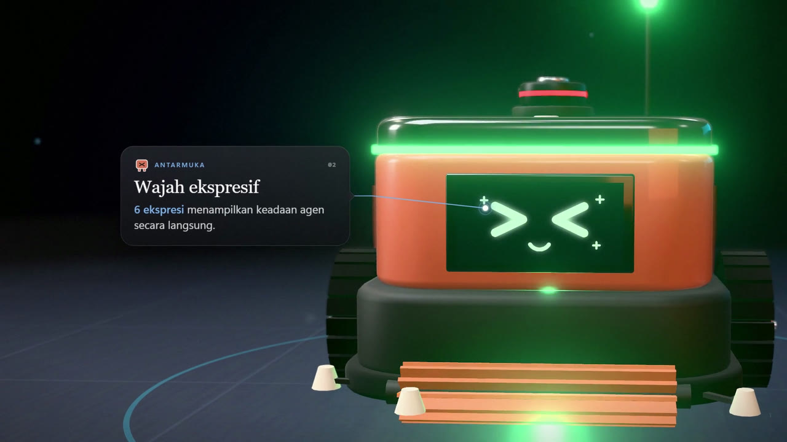

# CleanBot 3D — Perencanaan Rute Robot Pembersih di Ruang Kelas (A*)

**UAS Artificial Intelligence · Kelompok 6 · Kelas AI-D · UIN Malang**
Rafiq Alhariri Andriansyah (240605110178) · Ahmad Zamroni (240605110216) · Afzaal Abrar Hidayat (240605110206)

Lanjutan dari proposal UTS: robot pembersih memodelkan tugasnya sebagai **problem solving** (PEAS + 5 komponen formulasi),
lalu memakai **A\*** (pembanding: BFS dan UCS) untuk menyusun rencana yang mengunjungi semua titik kotoran dan kembali ke titik awal.
Pada UAS, rencana itu divisualkan sebagai **simulasi / game 3D realistis** yang dibangun dari tiga lapis:

| Lapis | Teknologi | Peran |
|---|---|---|
| Otak AI | **Python** (`cleanbot/`, FastAPI) | formulasi masalah, BFS · UCS · A\* · Greedy · Nearest-Neighbor, agen PEAS, benchmark, API |
| Aset 3D | **Blender 5.2** (`blender/`, bpy headless) | model robot CleanBot, meja, kursi, lemari, rak buku, papan tulis, sampah → ekspor `.glb`; render Cycles |
| Dunia 3D | **three.js** (`web/`) | render PBR real-time (bayangan matahari, ambient occlusion, bloom), animasi robot, HUD presentasi, mode game |

## Menjalankan (Windows)

```bash
pip install -r requirements.txt     # sekali saja (cukup fastapi, uvicorn, numpy untuk menjalankan aplikasi)
python server.py --open             # atau klik dua kali run.bat
```

Buka **http://localhost:8765**. Disarankan Chrome/Edge dengan akselerasi GPU aktif. Aplikasi bekerja offline
(three.js disertakan di `web/vendor/`). Bila server Python mati, skenario S1–S4 tetap bisa dijalankan dari data statis (`web/data/`).

### Kontrol

| Tombol | Fungsi | Tombol | Fungsi |
|---|---|---|---|
| **Spasi** | Mulai / jeda / lanjutkan | **1–5** | Kamera: Overview · Atas · Ikuti · Robot (FPV) · Sinema |
| **R** | Reset | **G / L** | Grid / LiDAR |
| **S** | Satu langkah (mode langkah) | **H** | Sembunyikan panel (mode presentasi bersih) |
| **+ / −** | Kecepatan | **M / P** | Suara / simpan gambar |

* **Alur agen**: ① Perumusan tujuan → ② perumusan masalah → ③ pencarian (heat-map ekspansi state di lantai) → ④ eksekusi (robot bergerak, menyedot sampah) → ⑤ selesai.
* **Panel kanan**: PEAS langsung (sensor jarak/debu, aktuator), state `s = ((x, y), {sisa target})` beserta **g(n), h(n), f(n)**, metrik pencarian, daftar aksi.
* **Lab algoritma**: perbandingan BFS / UCS / A\* (3 heuristik) / Greedy / Nearest-Neighbor pada S1–S4 + grafik skalabilitas.
* **Mode Editor**: klik lantai untuk menambah/menghapus kotoran dan perabot (atau “Acak denah”), lalu biarkan A\* merencanakan ulang.
* **Mode Game “Kamu vs AI”**: kendalikan robot dengan panah/WASD, bersihkan dengan Spasi, bandingkan biayamu dengan rencana optimal A\*.

## Skenario (S1–S3 sama dengan rancangan UTS, grid 8×5, start di pintu kiri-bawah)

| | Nama | Target | Biaya optimal | BFS (state) | UCS | A\* (MST) | A\* (jarak-max) |
|---|---|---|---|---|---|---|---|
| S1 | Sedikit Rintangan | 3 | 23 | 270 | 271 | **50** | 40 |
| S2 | Banyak Rintangan | 3 | 21 | 190 | 191 | **43** | 29 |
| S3 | Target Tersebar | 5 | 31 | 1086 | 1087 | **144** | 239 |
| S4 | Kelas Penuh (bonus 10×7) | 6 | 38 | 3254 | 3260 | **96** | 332 |

Semua algoritma optimal menghasilkan biaya yang sama; A\* hanya memeriksa 5–34× lebih sedikit state. Heuristik rakus
(Greedy / Nearest-Neighbor) pada S4 menghasilkan biaya 42 (+10,5% dari optimal), menegaskan bahwa **urutan kunjungan menentukan biaya**.

## Struktur proyek

```
cleanbot/          inti AI (Python)
  scenarios.py       denah S1–S4 + generator denah acak
  problem.py         5 komponen formulasi masalah: initial state, actions, transition model, goal test, path cost
  heuristics.py      h(n): Manhattan, jarak-max (BFS), MST + terdekat  (admissible & consistent)
  search.py          BFS, UCS, A*, Greedy, Nearest-Neighbor + metrik (state diperiksa, waktu, biaya)
  agent.py           PEAS + SIMPLE-PROBLEM-SOLVING-AGENT (dengan replanning bila rintangan muncul)
  api.py             jembatan JSON ke aplikasi 3D
  benchmark.py       benchmark + uji skalabilitas  →  results/
  export_dataset.py  ekspor dataset/ (denah + hasil benchmark, CSV/JSON) lalu verifikasi terhadap kode pencarian
  plots.py           grafik untuk laporan/PPT  →  results/figures/
dataset/           DATASET: 4 denah rancangan + 40 denah acak (masukan), hasil benchmark 7 algoritma (keluaran); lihat dataset/README.md
server.py          FastAPI: /api/meta, /api/plan, /api/benchmark + file statis
web/               aplikasi three.js (index.html, js/, css/, assets/, vendor/, data/)
blender/           pembangun aset (bpy): build_assets.py, asset_*.py, render_scene.py, make_textures.py
tests/             20 uji otomatis (pytest)
tools/             capture.py (tangkapan layar), record_demo.py (rekam video demo, jam virtual + ffmpeg),
                   record_launch.py + make_launch_audio.py (video peluncuran produk 30 dtk, lihat bagian "Video peluncuran")
docs_build/        pembuat PPT & laporan (pptxgenjs, docx-js, Word/WPS COM)
docs/              tangkapan layar & render pratinjau
```

## Mengulang pekerjaan

```bash
python -m pytest tests -q                    # 20 uji: optimalitas, admissibility, agen, kasus tepi
python -m cleanbot.benchmark                 # benchmark + grafik di results/
python -m cleanbot.export_dataset            # tulis ulang dataset/ (CSV/JSON) + verifikasi terhadap kode pencarian
python -m cleanbot.demo S3 --algo astar      # agen PEAS di terminal (ASCII)
python blender/make_textures.py              # tekstur prosedural (numpy)
"C:\Program Files\Blender Foundation\Blender 5.2\blender.exe" --background --factory-startup --python blender/build_assets.py
"C:\Program Files\Blender Foundation\Blender 5.2\blender.exe" --background --factory-startup --python blender/render_scene.py -- --scenario S3
python -m cleanbot.export_static             # data cadangan untuk web/data/
```

## Dokumen UAS (PPT dan Laporan)

Dibuat dari data proyek yang sama (hasil benchmark, tangkapan layar, render Blender) agar angka selalu konsisten.
Salinan siap pakai ada di folder [`dokumen/`](dokumen/).

| Berkas | Isi |
|---|---|
| `dokumen/UAS_AI_Mini_Project_Kelompok6_CleanBot3D.pptx` | 27 slide presentasi + catatan pembicara + video demo tertanam |
| `dokumen/Laporan_Mini_Project_UAS_AI_Kelompok6.docx` / `.pdf` | Laporan lengkap (Bab I–V, daftar pustaka, 4 lampiran) |
| `docs/demo_S4_720p.mp4` | Video demo cadangan 36 detik (tanpa suara); versi 1080p dibuat ulang dengan `tools/record_demo.py` |

Membangun ulang dokumen (perlu Node.js 18+; daftar isi laporan diisi lewat Microsoft Word/WPS di Windows):

```bash
npm --prefix docs_build install              # sekali saja (pptxgenjs, docx, sharp)
python docs_build/prep_images.py             # potongan HUD + versi JPEG ringan untuk PPT
python docs_build/prep_report.py             # gambar, diagram, dan data tambahan laporan
node docs_build/make_deck.js dokumen/UAS_AI_Mini_Project_Kelompok6_CleanBot3D.pptx
node docs_build/make_report.js dokumen/Laporan_Mini_Project_UAS_AI_Kelompok6.docx
python docs_build/word_finalize.py dokumen/Laporan_Mini_Project_UAS_AI_Kelompok6.docx   # isi daftar isi (COM) + ekspor PDF
python tools/record_demo.py                  # (opsional) rekam ulang video demo; server harus berjalan
python docs_build/make_progress_deck.py      # salinan PPT untuk laporan progres (slide tak terpakai disembunyikan, asli utuh)
```

Catatan: sampul laporan memuat dua penanda berlatar kuning (`[Nama Dosen Pengampu]` dan `[Program Studi / Fakultas]`) yang perlu diisi.

## Video peluncuran produk (30 detik)

Video bergaya peluncuran produk startup: zoom masuk/keluar yang halus pada robot, tanpa panel HUD, setiap bagian dijelaskan
dengan titik dan gelembung penjelasan (bukan percakapan). Babak 1 = studio (LiDAR, wajah, sikat, roda); babak 2 = robot bekerja di kelas
(A\* + eksekusi); penutup = angka kinerja. Gambar dirender dari aplikasi three.js yang sama (mode `?launch=`), suara disintesis dengan numpy.

| Berkas | Isi |
|---|---|
| `docs/launch_cleanbot_30s_720p.mp4` | 30 detik, 720p, 60 fps, dengan audio sintetis (1080p dibuat ulang dengan `tools/record_launch.py`) |
| `docs/launch_poster.jpg` | Gambar sampul |



```bash
python server.py                                  # di terminal terpisah
python tools/make_launch_audio.py                 # trek audio sintetis (numpy/scipy) -> docs_build/launch_audio.m4a
python tools/record_launch.py                     # 1080p 60 fps -> docs/launch_cleanbot_30s.mp4 (+ _720p), sekitar 3–4 menit
python tools/record_launch.py --stills 2.7,7,15   # PNG uji pada detik tertentu -> docs_build/stills
```

Pratinjau langsung (waktu nyata) di peramban: `http://localhost:8765/?launch=live&scenario=S4` (jendela 16:9, tekan F11).
Rekaman bersifat deterministik: simulasi dimajukan tepat 1/fps detik per bingkai (`launch.frame(t, dt)`), dan bagian agen yang
dipercepat dilewati saat layar hitam. Jadwal dan teks ada di `web/js/launch.js` (konstanta `T`, `K1`, `CALLOUTS`), gaya di `web/css/launch.css`.

## Catatan teknis

* Ruang state `s = (x, y, mask)`; `mask` = bitmask target yang belum bersih. Biaya 1 per aksi (gerak maupun bersihkan).
* Heuristik `mst`: MST(target tersisa ∪ titik awal) + jarak ke simpul terdekat + jumlah target — admissible & consistent (diuji otomatis).
* Sumbu: x grid → +X, y grid → +Z (selatan). Depan robot = +X. Satu sel = 1 m.
* Aplikasi tidak memerlukan internet; semua aset (GLB, tekstur, three.js) lokal.
